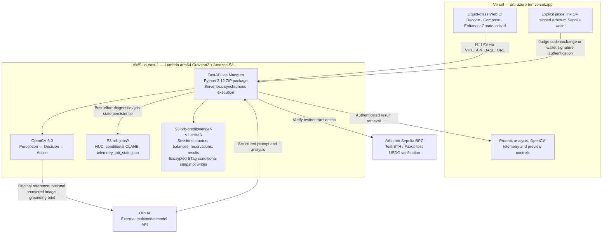

# Orb — OpenCV AI Competition 2026 (Powered by AWS) Technical Report & Submission Guide

**Orb** is a visual intelligence and creative prompt engineering platform.
**Decode** reconstructs a plausible generation prompt from an image or video;
**Compose** builds a new prompt inspired by a reference; **Enhance** refines an
existing text prompt. **Create** is visibly locked and coming soon. Orb currently
produces prompts, not generated media, and cannot guarantee the creator's exact
original prompt.

Orb combines an **OpenCV 5.0 Agentic Vision Engine** with **Orb AI** multimodal
synthesis. Pixel-derived measurements and conditional visual recovery ground
the synthesis; they do not guarantee elimination of model hallucinations.

The runtime and operational observations below were verified in the
**2026-10-24 read-only audit**. See [BENCHMARKS.md](BENCHMARKS.md) for provenance,
historical AWS samples and separately labeled local benchmark results.

## 1. Live architecture: Vercel → AWS Lambda / Mangum → OpenCV + Orb AI + S3



### Verified deployment footprint

- **Frontend:** `https://orb-azure-ten.vercel.app`
- **Backend:** `https://jsnwiqkw5sqs3c7hag6ywd3ngm0vljpc.lambda-url.us-east-1.on.aws/`
- **Lambda:** `orb-opencv5-api`, `us-east-1`, `Architectures=["arm64"]`, Python 3.12,
  **512 MB**, **120-second timeout**, active at audit.
- **Adapter:** `handler = Mangum(app, lifespan="auto")` in `prometheus/api/app.py`.
  `ORB_SERVERLESS_SYNC=1` makes accepted jobs execute before Lambda returns and
  freezes the invocation; scratch work uses `/tmp`.
- **Packaging:** The live function uses a **ZIP**, assembled by the arm64 wheel
  packager in `deploy/deploy_aws_lambda.py`. `Dockerfile.lambda` is a supported
  container-image build path, not the packaging of the audited live function.
- **OpenCV:** `opencv-python-headless==5.0.0.93`, with runtime
  `cv2.__version__ == "5.0.0"`. Deployed package metadata and the AArch64 native
  binary were inspected; historical telemetry reports ARM64 NEON / FP16.
- **Version pin:** `pyproject.toml`, `requirements.txt` and the ZIP deployer's
  package list pin `5.0.0.93`. The Lambda Dockerfile installs `requirements.txt`.
- **Public API origin:** Production Vercel's `VITE_API_BASE_URL` targets Lambda.

The repository also contains an EC2/Uvicorn/Cloudflared deployment path
(`deploy/aws_graviton_setup.sh`, `docker-compose.aws.yml`). That is an alternate
deployment option, not the architecture of the audited live service. Local
x86_64 AVX2 execution is likewise distinct from AWS arm64 execution.

### Health and readiness

`GET /api/health` returns application status, application version, analyzer
configuration, payment-gate status and AI-access state. The repository now also
registers `GET /health` on **the same handler**, returning the exact same JSON.
Neither response includes the OpenCV package version or architecture.

The October 24 audit observed `/api/health` and `/api/ready` returning **200**;
`/health` returned **404** before this alias fix. The alias must be deployed before
claiming live root-path success. `/api/ready` checks local upload prerequisites;
it does not execute an AI operation, purchase credits or prove an S3 write.

## 2. OpenCV agentic loop: Perception → Decision → Action

### Perception

- **Exposure:** BGR-to-LAB/HSV conversion, LAB L-channel histogram percentiles,
  mean luminance, contrast standard deviation and dynamic range.
- **Palette:** `cv2.kmeans` in **RGB space**, up to five clusters, returning
  RGB/hex centers and pixel weights. There is no separate LAB cluster palette;
  cluster initialization uses `KMEANS_PP_CENTERS` without a fixed RNG seed.
- **Focus and geometry:** Laplacian variance, Canny edge density, edge
  center-of-mass relative to rule-of-thirds points, and probabilistic Hough lines.
  `structural_lines.line_count` is in JSON; the UI shows line orientation rather
  than the numeric count.
- **Video:** Farnebäck dense optical flow, horizontal/vertical/radial motion
  summaries and HSV histogram correlation for visual continuity.

### Decisions and actions

1. **CLAHE recovery:** `mean_luminance < 60.0` **or** `contrast_std < 32.0`
   automatically triggers `cv2.createCLAHE(clipLimit=2.5, tileGridSize=(8, 8))`.
   Recovery modifies the LAB **L-channel**, retaining the A/B channels before
   conversion back to BGR, and writes `opencv_clahe_enhanced.jpg`. Original and
   recovered references can both be supplied to Orb AI.
2. **Keyframe ranking:** Video candidates are ranked by Laplacian variance;
   values below **45.0** are flagged as blurry. The sharpest candidate supplies
   primary OpenCV telemetry. Ranking/flags should not be described as proof that
   every blurry frame is removed from every downstream model call.
3. **Grounding:** `cv_grounding_brief` passes pixel measurements and action
   summaries into the multimodal synthesis context.
4. **HUD:** `opencv_hud_overlay.jpg` visualizes Canny contours, a rule-of-thirds
   grid, Hough structural lines, saliency crosshairs and RGB palette swatches;
   video HUDs can additionally include optical-flow vectors.

### What the results UI actually displays

The **OpenCV 5.0 Agentic Telemetry** card appears after Decode/Compose returns
visual telemetry; text-only Enhance results hide it. It shows:

- Runtime badge: **`OpenCV 5.0.0 · AWS S3 · ARM64 NEON`** in the audited AWS sample.
- OpenCV processing latency, effective throughput and conditional
  **`CLAHE Auto-Recovery: Active`**.
- **`AWS S3 Synced (orb-opencv5-vision-2026)`** when the sync metadata qualifies.
- Exposure, Laplacian sharpness, Canny edge density, saliency, Hough orientation,
  hex/weight palette swatches, and video motion/continuity when present.
- Action/trigger logs and **Original Reference**, **OpenCV Vision HUD**,
  **CLAHE Shadow Recovery** preview tabs when their artifacts are available.

Production telemetry records original-frame measurements and recovery actions;
it does **not** compute or log post-CLAHE edge-density gain. The audited corridor
reference measured approximately **+66.1%** Canny edge-density gain in an
independent comparison against its stored recovery artifact. That is
image-dependent, not a universal **+142–184%** claim. Local synthetic benchmark
gains are separately labeled in `BENCHMARKS.md`.

## 3. Judge instant access and the public Web3 boundary

**Judge link:** `https://orb-azure-ten.vercel.app/?judge=OPENCV2026`

- The exact explicit query parameter is required by the frontend. Backend
  capability confirmation precedes automatic `POST /api/orb/judge-session`.
  Activation does not request wallet connection, signing or payment.
- A new judge session normally receives **10 evaluation credits**, bounded by
  remaining daily capacity. Exhausted limits return 429. Judge credits are
  separate from purchased wallet credits and cannot purchase more credits.
- The query is **retained** so reload stays in explicit judge mode. A valid cached
  judge session is restored on that link without another grant.
- Judge controls, including the header button/code form, are available only on
  the explicit judge link after backend confirmation. They are hidden on clean
  public URLs; they are not a public payment-failure bypass.
- Clean `/` visits clear cached Orb judge sessions/flags from localStorage and
  sessionStorage, while retaining unrelated wallet state. This does not delete
  server-side balances.
- Config defaults `judge_demo_enabled` to false; a matching code or valid judge
  bearer session can enable it. Config responses are `private, no-store`.
- Backend checks use `hmac.compare_digest`. The audited deployment uses
  **150 global runs/day** and **25 judge sessions/IP/day**. These limits constrain
  usage; they do not guarantee that automated access is impossible.

Public consumers authenticate with an EVM wallet on **Arbitrum Sepolia**:
**421614 / `0x66eee`**, using `https://sepolia-rollup.arbitrum.io/rpc`. Both native
test ETH and Paxos test USDG were enabled at audit. Credits are testnet/demo
credits with no real-money value. One successful Decode, Compose or Enhance
consumes one credit; failed processing releases its reservation.

## 4. Amazon S3 persistence and atomic credit accounting

### Diagnostic artifacts and job state

With `ORB_AWS_S3_BUCKET=orb-opencv5-vision-2026` and AWS credentials (including
Lambda execution-role credentials), the artifact module uploads available files:

```text
s3://orb-opencv5-vision-2026/orb-jobs/<job_id>/opencv_hud_overlay.jpg
s3://orb-opencv5-vision-2026/orb-jobs/<job_id>/opencv_clahe_enhanced.jpg
s3://orb-opencv5-vision-2026/orb-jobs/<job_id>/opencv_telemetry.json
s3://orb-opencv5-vision-2026/orb-jobs/<job_id>/job_state.json
```

The CLAHE image exists only when recovery triggers. S3 diagnostic uploads are
**best-effort**, with bounded per-request connection/read timeouts, and are
separate from credit settlement. They are not an atomic multi-object upload.
`aws_s3.synced` means at least one candidate uploaded; inspect the returned
`keys` for completeness. The stored telemetry JSON is uploaded before final sync
metadata is added, so it need not contain the final `aws_s3` result.

The backend can issue 24-hour pre-signed HUD/CLAHE URLs and fallback-read
diagnostics/job JSON from S3 across Lambda containers. Original uploaded media
is not part of this diagnostic S3 upload set; its local `/tmp` preview is
ephemeral and should not be described as durably retained.

### Shared credit/result ledger

The audited Lambda has no `ORB_DATABASE_URL`; its authoritative ledger is:

```text
s3://orb-opencv5-vision-2026/orb-credits/ledger-v1.sqlite3
```

Each operation reads a fresh SQLite snapshot into memory. Grants, sessions,
quotes, accepted transactions, balances, reservations and durable result JSON
share this ledger. Publication uses **AES256 encryption** and S3 **`If-Match`**
against the loaded ETag; initial bootstrap uses **`If-None-Match: *`**. Conflicts
retry the complete operation against a fresh snapshot, up to eight attempts.
Storage failures fail closed rather than granting/spending against stale state.

Result persistence precedes successful credit settlement. These are separate
conditional-write operations; an interruption between them can leave a durable
result with a reserved credit. Cold starts do not blindly release another live
invocation's reservation. The snapshot ledger is capped at **16 MiB**; the
repository also supports Postgres for larger workloads.

The October 24 read-only audit found a valid encrypted ledger, three consumed
reservations with durable results, and no balance/reservation inconsistencies.
Concurrency/failure handling was exercised through mocked S3/RPC tests, not a
new production debit. See [Lambda credit persistence](docs/LAMBDA_CREDIT_PERSISTENCE.md).

## 5. Performance evidence and validation limits

- Historical AWS OpenCV analysis of the **1280×720** corridor reference reported
  **1,578.769 ms** and **2,233.344 ms**. These are individual observations, not
  1080p averages or an SLA.
- The original demo capture recorded **46.67 seconds** for upload, polling,
  result and artifact retrieval. Its edited interaction timings are not a
  real-time performance recording.
- The recorded local x86_64 AVX2 synthetic **1080p standard-scene mean is
  260.9 ms**; its best run was 166.08 ms. No controlled sub-180 ms 1080p Lambda
  result has been established.
- The audit used read-only live HTTP/AWS/S3 inspection, temporary local CV work,
  existing automated tests and deployed-browser replay with intercepted
  session/job responses. It did not create a new live judge grant, paid AI job,
  wallet signature or blockchain transaction. Replay verifies frontend behavior,
  not a fresh production end-to-end purchase/Decode.

Local regression verification after the health-alias, dependency-pin and
documentation fixes on October 24: **339 backend tests passed**, with **8
Postgres integration skips**, and **237 frontend tests passed across 10 files**.
The existing health test checks HTTP 200 and identical JSON from both aliases.
These local results do not imply that this revision has been deployed.

## 6. Local preview and deployment references

Install the repository's pinned dependencies and configure the existing backend
provider credentials privately. For the current provider, the environment name
is `GEMINI_API_KEY`; no credential belongs in frontend `VITE_` variables.

```powershell
$env:ORB_ENV = "local"
$env:ORB_JUDGE_DEMO_CODE = "OPENCV2026"
$env:ORB_JUDGE_DAILY_CAP = "150"
# Configure the backend API key in the local environment or ignored .env.
.\.venv\Scripts\python.exe -m uvicorn prometheus.api.app:app --host 127.0.0.1 --port 8000
```

Open `http://127.0.0.1:8000/?judge=OPENCV2026`. The active header reads
**Judge Demo · Active**, with credits displayed separately. Analyze a dark
reference to inspect the telemetry and available preview tabs. Do not label a
local machine as AWS by setting `ORB_COMPUTE_ENV=AWS`.

For an explicitly authorized deployment of the existing Lambda ZIP function:

```powershell
.\.venv\Scripts\python.exe deploy/deploy_aws_lambda.py --mode zip
```

The deployer preserves the existing function's package type and runtime settings;
it does not replace a ZIP function with a container deployment. Vercel Production
should keep `VITE_API_BASE_URL` set to the audited Lambda origin. Share the exact
judge link above for evaluation access.
