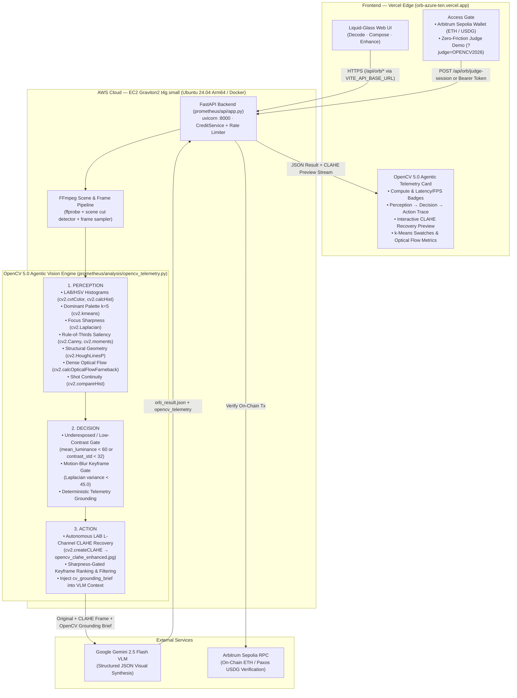

# Orb — OpenCV AI Competition 2026 (Powered by AWS) Technical Report & Submission Guide

**Orb** is a visual intelligence and creative prompt engineering platform that decodes images and videos into structured cinematic breakdowns and production-ready generation prompts (`Decode`, `Compose`, and `Enhance`).

Built for the **OpenCV AI Competition 2026 (Powered by AWS)**, Orb pairs a deterministic **OpenCV 5.0 Agentic Vision Engine** (`opencv-python-headless==5.0.0.93`) running on **AWS Graviton (Arm64 NEON / x86_64 AVX2)** with **Google Gemini VLM** synthesis—eliminating vision-language model hallucinations by grounding every prompt in physical pixel measurements and executing autonomous pre-inference visual recovery actions.

---

## 1. System Architecture (`Vercel -> AWS Graviton + OpenCV 5.0 -> Gemini VLM`)



---

## 2. Agentic Vision Loop (`Perception -> Decision -> Action`)

Pure VLM pipelines frequently hallucinate lighting keys, color hex codes, camera motion directions, or miss shadow detail in dark scenes. Orb solves this with a closed **Perception $\rightarrow$ Decision $\rightarrow$ Action** loop powered by **OpenCV 5.0** before Gemini ever sees the media:

### Step 1: Deterministic OpenCV 5.0 Perception
- **Photometric & Color Perception (`cv2.cvtColor`, `cv2.calcHist`, `cv2.kmeans`):**
  Converts BGR frames into CIE **LAB** and **HSV** color spaces, computes cumulative histogram percentiles (`p5` to `p95` dynamic range), `mean_luminance` ($0\text{--}255$), and `contrast_std` ($\sigma$), and runs $K$-means clustering ($K=5$, `cv2.KMEANS_PP_CENTERS`) to extract exact dominant RGB Hex codes and pixel weights.
- **Focus & Compositional Geometry (`cv2.Laplacian`, `cv2.Canny`, `cv2.moments`, `cv2.HoughLinesP`):**
  Measures high-frequency focus variance via $\text{Var}(\nabla^2 I)$, computes spatial edge center-of-mass relative to Rule-of-Thirds power points via `cv2.Canny` + `cv2.moments`, and classifies structural line orientation (`horizontal-dominant`, `vertical-dominant`, `diagonal/dynamic`, `organic/curved`) via probabilistic Hough transforms (`cv2.HoughLinesP`).
- **Temporal Motion & Shot Continuity (`cv2.calcOpticalFlowFarneback`, `cv2.compareHist`):**
  Computes dense Farnebäck optical flow across video frames, decomposing 2D motion fields into horizontal pan (`mean_dx`), vertical tilt (`mean_dy`), and radial zoom (`radial_flow` via dot product with unit radial vectors), while correlating 2D Hue-Saturation histograms (`cv2.HISTCMP_CORREL`) to detect cuts vs. continuous takes.

### Step 2: Autonomous Agentic Decisions & Actions
1. **Autonomous CLAHE Shadow & Contrast Recovery (`clahe_shadow_contrast_recovery`):**
   - **Perception Trigger:** `mean_luminance < 60.0` or `contrast_std < 32.0`.
   - **Autonomous Action:** Applies Contrast-Limited Adaptive Histogram Equalization (`cv2.createCLAHE(clipLimit=2.5, tileGridSize=(8, 8))`) specifically to the LAB luminance channel (`L`) so chrominance (`A`, `B`) remains uncorrupted. Writes `opencv_clahe_enhanced.jpg` to the job directory, exposes `/api/jobs/{id}/frames/opencv_clahe_enhanced.jpg` to the UI, and attaches **both** the original reference and the CLAHE-recovered image to the Gemini VLM call so shadow structures are recovered without losing the original mood.
2. **Sharpness-Gated Keyframe Prioritization (`sharpness_gated_keyframe_ranking`):**
   - **Perception Trigger:** Video frames scored via `cv2.Laplacian(gray, cv2.CV_64F).var()`. Frames below `45.0` are flagged as `flagged-blurry`.
   - **Autonomous Action:** Ranks all candidate keyframes by focus sharpness, selects the sharpest keyframe for primary photometric/geometric telemetry, and logs the full sharpness ranking so motion-blurred transition frames do not degrade VLM synthesis.
3. **Deterministic Prompt Grounding (`cv_grounding_brief`):**
   - **Autonomous Action:** Compiles all OpenCV 5.0 measurements into a `[OpenCV Deterministic Telemetry — Ground your analysis in these physical measurements]` block injected directly into `OrbAIService.image()`, `OrbAIService.compose_video()`, and `_BaseRemoteAnalyzer._user_instruction()`.

---

## 3. Zero-Friction Competition Judge Demo Mode

To ensure competition judges can test the live deployment immediately without needing an Arbitrum Sepolia wallet or testnet ETH/USDG, while keeping our Gemini API quota 100% protected against automated scraping:

- **One-Click URL Auto-Unlock:** Opening `https://orb-azure-ten.vercel.app/?judge=OPENCV2026` (or `http://127.0.0.1:8000/?judge=OPENCV2026` locally) automatically exchanges the competition code via `POST /api/orb/judge-session`, mints a server-verified session pre-loaded with **10 demo credits**, and strips `?judge=...` from the address bar via `history.replaceState`.
- **Header Button Unlock:** Judges can also click **`Judge Demo`** in the top-right header, enter `OPENCV2026`, and unlock 10 credits immediately.
- **Server-Side Quota Protection:** Verified with constant-time `hmac.compare_digest`, bounded by `ORB_JUDGE_DAILY_CAP=150` runs/day globally and `ORB_JUDGE_IP_DAILY_LIMIT` per-IP session limits.

---

## 4. How to Preview Locally Right Now

Run the full Orb stack (FastAPI backend + OpenCV 5.0 Agentic Engine + Web UI) locally on port `8000`:

```powershell
# 1. Set Judge Demo Mode & local environment variables in PowerShell
$env:ORB_ENV = "local"
$env:ORB_JUDGE_DEMO_CODE = "OPENCV2026"
$env:ORB_JUDGE_DAILY_CAP = "150"
$env:ORB_COMPUTE_ENV = "AWS"
# Ensure GEMINI_API_KEY is set in your environment:
# $env:GEMINI_API_KEY = "your_gemini_api_key"

# 2. Launch the FastAPI + OpenCV 5.0 server
.\.venv\Scripts\python.exe -m uvicorn prometheus.api.app:app --host 127.0.0.1 --port 8000
```

Then open **`http://127.0.0.1:8000/?judge=OPENCV2026`** in your browser:
1. The header badge will automatically activate **`Judge Demo · 10 cr`**.
2. Upload any image or video in **Decode** or **Compose** mode (try a dark/low-contrast photo to watch Autonomous CLAHE Shadow Recovery trigger!).
3. On the Results screen, inspect the **OpenCV 5.0 Agentic Vision Telemetry** card:
   - Benchmark pills (`OpenCV 5.0.0 · ...`, `Latency: <ms>`, `Throughput: <FPS>`, `CLAHE Auto-Recovery: Active`).
   - Step-by-step **Perception $\rightarrow$ Decision $\rightarrow$ Action** log and interactive **"View OpenCV CLAHE Shadow Recovery"** preview toggle.
   - 5-color $K$-means Hex palette swatches and full CV measurement breakdown.

---

## 5. Deploying to AWS Graviton (`t4g.small` Free Tier) & Connecting Vercel

### Step A: Launch on AWS EC2 Graviton2 (`arm64`)
1. In the AWS Console, launch an **Ubuntu Server 24.04 LTS (HVM), SSD Volume Type — 64-bit (Arm)** instance using the free-tier eligible **`t4g.small`** (or `t4g.micro`) instance type.
2. Allow inbound TCP ports `22` (SSH), `80` (HTTP), `443` (HTTPS), and `8000` (API) in the Security Group.
3. SSH into the instance, clone the repository, and run the automated setup script:

```bash
git clone <your-repo-url> project-orb
cd project-orb
chmod +x deploy/aws_graviton_setup.sh
./deploy/aws_graviton_setup.sh
```

4. Add your `GEMINI_API_KEY` to `.env` and restart the container:

```bash
nano .env
sudo docker compose -f docker-compose.aws.yml up -d
```

5. Expose HTTPS on your AWS Graviton public IP using Caddy + `nip.io` (zero domain cost, automatic Let's Encrypt TLS certificate required by Vercel):

```bash
sudo apt-get install -y caddy
PUBLIC_IP=$(curl -fsS https://checkip.amazonaws.com | tr -d '\n')
sudo caddy reverse-proxy --from "${PUBLIC_IP}.nip.io" --to 127.0.0.1:8000
```

Your AWS Graviton HTTPS API origin is now live at `https://<EC2-PUBLIC-IP>.nip.io` (or your custom domain).

### Step B: Point `orb-azure-ten.vercel.app` to the AWS Backend
As confirmed in `vercel.json`, `web/api-url.js`, and `scripts/check-vercel-env.mjs`, the Vercel frontend routes all `/api/*` requests to the origin configured in the **`VITE_API_BASE_URL`** environment variable at build time (currently pointing to `https://orb-api-7qwv.onrender.com`):

1. Open **Vercel Dashboard $\rightarrow$ Project (`orb`) $\rightarrow$ Settings $\rightarrow$ Environment Variables**.
2. Update **`VITE_API_BASE_URL`** to your AWS Graviton HTTPS origin (e.g., `https://<EC2-PUBLIC-IP>.nip.io`).
3. Redeploy the `main` branch on Vercel (`npm run build:vercel` validates `VITE_API_BASE_URL` via `scripts/check-vercel-env.mjs` and builds `web_dist`).
4. Share the zero-friction judge link in your competition submission form:
   **`https://orb-azure-ten.vercel.app/?judge=OPENCV2026`**
